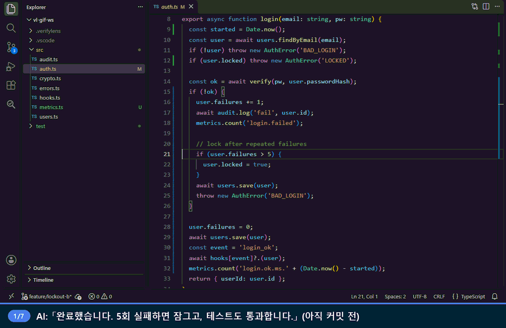

# VerifyLens

**AI가 만든 코드를 믿기 전에, 요구사항마다 실제로 어떻게 동작하는지 보여 줍니다.**

[English README](README.md)

**[브라우저에서 바로 해 보기 →](https://damunkorea.github.io/verifylens/?lang=ko)** 설치하지 않아도 됩니다. 요구사항과 코드를 넣어 보세요. 넣은 내용은 페이지 밖으로 나가지 않습니다.

AI가 「요구사항 전부 반영, 완료」라고 답하고, **테스트도 전부 통과했습니다.** 그래도 요구사항대로가 아닐 수 있습니다.

```text
요구사항      연속 5회 실패하면 계정을 잠근다
AI가 쓴 코드   if (user.failures > 5) { user.locked = true }
AI가 쓴 테스트  'locks the account after 5 consecutive failures'  → 통과 ✓
VerifyLens    ← R2 · 다름 · 6번째 시도에 동작 (요구사항 5회) · 검사는 통과
```

AI가 코드와 테스트를 같은 오해로 썼습니다. 테스트 이름은 「5회」지만 실제로는 여섯 번 틀린 뒤에 확인합니다. 그래서 **테스트는 전부 통과하는데 요구사항과는 다릅니다.** 테스트만 돌려서는 보이지 않고, 조건식에서 동작 시점을 직접 계산해야 보입니다.

VerifyLens는 요구사항마다 **확인됨 · 다름 · 미확인**을 보여 주고, 근거가 된 코드 줄과 실제로 돌린 검사로 바로 이어 줍니다. 테스트가 실패하는 경우는 물론이고, 위처럼 테스트가 통과해도 숫자 조건이 요구사항과 다르면 알려 줍니다.



<sub>실제 VS Code 확장 화면을 찍은 것입니다 (25초).</sub>

> **상태: v0 프로토타입.** TypeScript · JavaScript 저장소에서 처음부터 끝까지 돌아가지만 아직 초기 버전입니다. 이번 공개의 목적은 **의견을 듣는 것**입니다. 아래 [의견 주기](#의견-주기)를 봐 주세요.

## 무엇이 다른가

- **AI 의견을 하나 더 얹지 않고 근거를 묶습니다.** v0는 **LLM을 쓰지 않습니다.** 정적 분석(TypeScript 컴파일러 API), git 변경 내용, 실제로 돌린 테스트 결과(JUnit XML)만 씁니다. 모든 표시는 코드나 검사 기록으로 이어집니다.
- **모르는 것은 「미확인」으로 남깁니다.** 검사가 없거나 해석할 수 없는 호출이 있으면 「문제없음」이라고 하지 않습니다.
- **PR을 올리기 전에, 에디터에서.** 커밋하지 않은 변경까지 작업 폴더를 그대로 보고, 파일을 저장하면 다시 확인합니다. AI 리뷰 봇은 PR이 올라온 뒤에 판정하지만, 이 도구는 AI가 방금 고친 코드가 눈앞에 있을 때 알려 줍니다.
- **코드는 내 PC 밖으로 나가지 않습니다.** 분석은 네트워크를 쓰지 않고, 계정이나 API 키도 필요 없습니다. 리포트는 외부 자원을 불러오지 않는 HTML 파일 하나입니다. (에디터 확장에서 요구사항을 채울 때 원하면 내 `gh`로 PR · 이슈의 *글*만 읽어 올 수 있습니다. 코드는 보내지 않습니다.)
- **판단은 사람이 합니다.** 사용 · 수정 · 추가 검증 판단을 근거 옆에 기록합니다.

## 빠르게 해 보기

**Node.js 22.18 이상**(TypeScript를 바로 실행)과 git이 필요합니다.

```bash
git clone <이 저장소>
cd verifylens
npm install
npm run demo        # 샘플 저장소를 만들고 테스트를 돌린 뒤 컨셉 시연을 엽니다
```

Windows에서는 `demo-windows.cmd`를 더블클릭해도 됩니다. PowerShell에서 「이 시스템에서 스크립트를 실행할 수 없으므로」 오류가 나면 `npm.cmd install`, `npm.cmd run demo`로 실행하세요.

데모는 임시 git 저장소에 같은 작업(「로그인 5회 연속 실패하면 계정 잠금」)의 AI 결과 두 개를 만듭니다. 결과 A는 `failures >= 5`, 결과 B는 `failures > 5`이고 B에는 AI가 같이 쓴 테스트가 들어 있습니다. 둘 다 완료라고 하고 **테스트도 둘 다 전부 통과**합니다. VerifyLens는 조건식을 계산해서 B가 **6번째** 시도에서야 잠근다는 것, 그런데도 B의 검사가 통과했다는 것을 보여 줍니다.

결과는 `out/`에 생깁니다.

| 파일 | 내용 |
|---|---|
| `out/concept.html` | 에디터 같은 화면 안에서 단계별로 보는 컨셉 시연 (→ / Space 로 다음) |
| `out/report.html` | 전체 리포트: 요구사항별 상태, 근거 사슬, 코드 비교, 시도 횟수별 동작 시점, 흐름 지도 |
| `out/summary.md` | 같은 내용을 글로만 정리한 요약 |

## Release 현황

마지막 확인: 2026-11-21

| 채널 | 버전 | 상태 |
|---|---|---|
| [GitHub Release](https://github.com/DamunKorea/verifylens/releases/tag/v0.17.0) | 0.17.0 | 공개 |
| [VS Code 장터](https://marketplace.visualstudio.com/items?itemName=damun.verifylens) | 0.17.0 | 공개 |
| [Open VSX](https://open-vsx.org/extension/damun/verifylens) | 0.17.0 | 공개 |
| Cursor 확장 검색 | 0.15.0 | Open VSX에서 복사 대기 |
| [JetBrains 미리 보기 (GitHub)](https://github.com/DamunKorea/verifylens/releases/tag/jetbrains-v0.10.0) | 0.10.0 | zip으로 설치 가능 |
| JetBrains 장터 | 0.4.1 | 심사 중 |

판마다 같은 방법으로 잰 결과: [docs/benchmark.md](docs/benchmark.md)

## VS Code · Cursor 확장 (미리 보기)

같은 엔진이 에디터 안에서, 원래 있던 기능처럼 돌아갑니다. 왼쪽에 요구사항 목록이 열리고, 근거가 된 줄 끝에 설명이 붙습니다(예: `← R2 · 다름 · 6번째 시도에 동작 (요구사항 5회) · 검사는 통과`). 마우스를 올리면 근거 표가 나오고, A ↔ B는 VS Code 기본 비교 화면으로 나란히 봅니다. 확인이 필요한 줄은 문제(Problems) 목록에 올라가고, 커밋하면 스스로 다시 분석합니다. VS Code와 Cursor 3.29에서 확인했습니다(같은 `.vsix`). Cursor에서는 에디터 창에서 쓰세요. 에이전트 창에서는 확장이 읽히지 않습니다. 다른 VS Code 기반 에디터에도 같은 파일이 설치되는 조건이지만 직접 확인하지는 못했습니다.

**설치**

- **VS Code:** 확장 검색에서 **VerifyLens**를 찾아 **설치**를 누릅니다([장터 페이지](https://marketplace.visualstudio.com/items?itemName=damun.verifylens)).
- **Cursor:** 확장 검색에서 **VerifyLens**를 찾아 **설치**를 누릅니다. [Open VSX](https://open-vsx.org/extension/damun/verifylens)에서 받아 옵니다. Open VSX를 쓰는 다른 에디터(VSCodium, Windsurf)에서도 같은 방법으로 찾을 수 있을 것으로 보지만, 직접 확인하지는 않았습니다.
- **파일로 넣기:** [최신 Release](https://github.com/DamunKorea/verifylens/releases/latest)에서 `.vsix`를 받아 **확장 → ⋯ → VSIX에서 설치…**로 넣습니다.

왼쪽 VerifyLens 아이콘을 누르고 **샘플로 해 보기**를 누르세요. 화면 글은 VS Code 화면 언어를 따릅니다. VS Code를 영어로 쓰면 영어(**Try the sample**)로 나오고, 설정 `verifylens.language`를 `ko`로 두면 언제나 한국어로 나옵니다. `.vsix`를 직접 만들려면:

```bash
cd vscode
npm install
npm run package     # verifylens-<버전>.vsix 를 만듭니다
```

자세한 내용은 [vscode/README.md](vscode/README.md)에 있습니다.

## JetBrains IDE 플러그인 (미리 보기)

IntelliJ IDEA · WebStorm 같은 JetBrains IDE용입니다. VS Code 확장과 같은 엔진을 그대로 돌리므로 판정이 같습니다. 왼쪽 **VerifyLens** 도구 창에 한 줄 요약과 요구사항별 상태 · 근거 줄이 나오고(누르면 그 줄로 이동), 근거 줄에는 줄 번호 옆 아이콘과 줄 끝 설명이 붙습니다. **내 변경 확인**은 커밋 전 변경까지 기준 브랜치와 비교하고, 파일이 저장되면 스스로 다시 확인합니다. **샘플로 해 보기**도 있습니다. 화면 글은 IDE 화면 언어를 따라 한국어 · 영어로 나옵니다.

- **필요한 것:** 2026.1 이상의 JetBrains IDE, 이 PC의 **Node.js 18 이상**(엔진을 Node로 돌립니다. 없으면 무엇을 설치할지 알려 줍니다), git.
- **설치:** JetBrains Marketplace 심사 중이라 아직 검색되지 않습니다. [JetBrains 미리 보기 Release](https://github.com/DamunKorea/verifylens/releases/tag/jetbrains-v0.10.0)에서 `verifylens-jetbrains-0.10.0.zip`을 받아(압축을 풀지 말고) IDE의 **Settings → Plugins → ⚙ → Install Plugin from Disk…**에서 고릅니다. 직접 만들려면 아래처럼 합니다.
- **한계:** 테스트 실행 단추, 요구사항 가져오기, PR 요약 복사, 리포트 화면, 두 브랜치 비교는 아직 없습니다. IntelliJ IDEA 2026.3과 Android Studio 2026.1(같은 IntelliJ 플랫폼)에서 자동 시험과 실제 창(IntelliJ IDEA, 영어 · 한국어)으로 확인했고, WebStorm에서는 아직 직접 돌려 보지 못했습니다.

```bash
cd jetbrains
./gradlew buildPlugin     # build/distributions/verifylens-jetbrains-0.10.0.zip 을 만듭니다
```

빌드에 필요한 것과 확인한 범위는 [jetbrains/README.md](jetbrains/README.md)에 있습니다.

## 내 저장소에 쓰기

```bash
# 1) PR 설명에서 요구사항 초안을 뽑고 직접 고칩니다
node src/cli.ts extract --pr-body pr.md > requirements.md
#    형식: - R2: 연속 5회 실패하면 계정을 잠근다

# 2) 브랜치 하나, 또는 두 결과를 비교하는 리포트를 만듭니다
node src/cli.ts report --repo ../내저장소 --base main --a feature/x [--b feature/y] \
     --requirements requirements.md [--junit-a a.xml --junit-b b.xml] --out out --open
```

- 요구사항은 한국어나 영어 문장만 적으면 코드와 자동으로 이어집니다(영어는 문장의 낱말로, 한국어는 자주 쓰는 말의 고정 용어집으로, LLM 없음). 엉뚱한 코드에 이어지면 뒤에 `| keywords: 코드에, 나오는, 단어`를 붙여 직접 정하세요. 자동 연결은 검사를 일부러 좁게 잇습니다. 검사 이름이 요구사항의 대부분을 담아야만 인정해서, 검사가 없으면 「미확인」으로 남습니다.
- 검사 결과는 JUnit XML을 읽습니다. 예: `node --test --test-reporter=junit --test-reporter-destination=a.xml`. 검사 결과가 없으면 「미실행」으로 표시합니다.

## CI 에서 쓰기 (GitHub Actions)

PR 이 많아 하나씩 볼 수 없을 때, PR 마다 VerifyLens 를 돌릴 수 있습니다. 「다름」인 요구사항의 근거 줄에 표시를 남기고, 작업 페이지에 요약을 쓰고, 검사를 실패로 끝냅니다.

```yaml
# .github/workflows/verifylens.yml
name: VerifyLens
on: pull_request
jobs:
  verifylens:
    runs-on: ubuntu-latest
    steps:
      - uses: actions/checkout@v5
        with:
          fetch-depth: 0          # 기준 브랜치와 비교하려면 필요합니다
      # 선택: 테스트를 JUnit 결과로 남기면 검사까지 함께 봅니다. 예:
      # - run: npx vitest run --reporter=junit --outputFile=junit.xml
      - uses: DamunKorea/verifylens@v0.17.0
        with:
          requirements: .verifylens/requirements.md
          junit: junit.xml        # 결과 파일이 없으면 지웁니다
          fail-on: different,failed   # 엄격하게 하려면 unverified 도 넣습니다
          lang: ko
```

코드는 러너 안에서만 분석하고 밖으로 보내지 않습니다. 같은 검사를 PC 에서는 `node src/cli.ts ci --repo . --base origin/main --requirements .verifylens/requirements.md` 로 돌립니다.

## AI 에이전트가 「끝났다」고 하기 전에 검사하기 (훅)

`ci --hook` 은 에이전트가 방금 고친 코드를 커밋하기 전에 검사합니다. 작업 폴더(커밋한 것, 커밋 전 수정, 새 파일)를 `origin/main`과 비교하고, 없으면 `main` · `origin/master` · `master` 중 있는 것과 비교합니다. `--base` 로 정할 수도 있습니다. 커밋 전 코드 변경이 있을 때만 돌기 때문에, 에이전트가 질문에 답만 한 차례는 검사하지 않습니다.

- 요구사항이 **「다름」** 이나 **「실패」** 면 에이전트에게 한 번 고치라고 돌려보냅니다. 요구사항, 이유, 근거 줄과 경계에서 시험할 값(요구사항의 숫자에서 뽑음, 예: 4번째 · 5번째 실패)을 알려 주고, 요구사항 파일을 고치지 말고 사용자에게 물으라고 합니다.
- 한 번 고친 뒤에도 그대로면 에이전트를 다시 막지 않고, 사용자에게 알림만 남깁니다.
- **「미확인」** 은 `--fail-on different,failed,unverified` 를 넣을 때만 막습니다.
- 요구사항 파일은 프로젝트의 `.verifylens/requirements.md` 입니다(`--requirements` 로 바꿈). 이 파일이 없는 프로젝트는 건너뛰므로, 훅을 사용자 설정에 넣어도 됩니다.
- `--junit report.xml` 로 테스트 결과를 함께 봅니다. 코드보다 오래된 결과는 쓰지 않습니다.
- **실패했던 검사를 다시 돌렸는지 봅니다.** 실패한 검사 이름을 git 폴더 안(`.git/verifylens-failed-tests.json`, 커밋되지 않음)에 적어 두고, 코드가 바뀐 뒤 새 결과에 그 검사가 없거나 결과가 코드보다 오래됐으면 「다시 돌리지 않음」으로 알립니다. 훅은 그 검사 이름을 짚어 한 번 다시 돌리라고 돌려보내고, 「실패」 요구사항에는 실패한 검사 이름도 함께 적습니다. 통과하면 목록에서 지웁니다. (X 댓글에서 받은 생각: 버그를 고쳤다고 하기 전에 원래 실패하던 단계를 그대로 다시 돌린다)

아래 `/path/to/verifylens` 는 VerifyLens 를 받아 설치한 폴더입니다([빠르게 해 보기](#빠르게-해-보기) 참고). Windows 에서도 `/` 를 쓰고, 경로에 빈칸이 있으면 따옴표로 감쌉니다.

**Claude Code** — 프로젝트의 `.claude/settings.json`. Claude 는 이 말을 「멈추지 말고 계속할 이유」로 받습니다(`"decision": "block"`).

```json
{
  "hooks": {
    "Stop": [
      {
        "hooks": [
          { "type": "command", "command": "node --no-warnings /path/to/verifylens/src/cli.ts ci --hook claude", "timeout": 120 }
        ]
      }
    ]
  }
}
```

**Cursor** — 프로젝트의 `.cursor/hooks.json`. Cursor 는 이 말을 에이전트에게 다음 메시지로 보냅니다(`followup_message`).

```json
{
  "version": 1,
  "hooks": {
    "stop": [
      { "command": "node --no-warnings /path/to/verifylens/src/cli.ts ci --hook cursor" }
    ]
  }
}
```

**git pre-commit** — `.git/hooks/pre-commit` (실행 권한을 줍니다). 「다름」 · 「실패」가 있으면 커밋을 멈춥니다. `--worktree` 는 스테이징하지 않은 변경도 봅니다. `git commit --no-verify` 로 건너뜁니다.

```sh
#!/bin/sh
node --no-warnings /path/to/verifylens/src/cli.ts ci --worktree
```

Windows 에서 각 도구가 주는 훅 입력을 명령에 그대로 넣어 시험했습니다(`vscode/test/ci.test.ts`). 실제 Claude Code · Cursor 세션 안에서는 아직 돌려 보지 않았습니다.

## 리포트 읽는 법

| 표시 | 뜻 |
|---|---|
| 확인됨 | 모든 결과에서 구현 근거를 찾았고 연결된 검사가 모두 통과 |
| 다름 | 결과 간 조건이 다르거나, 요구사항의 숫자와 코드의 경계가 맞지 않거나, 한쪽만 검사가 실패 |
| 실패 | 연결된 검사가 실패 |
| 미확인 | 구현 근거가 약하거나 연결된 검사가 없음 |

화면은 위에서 아래로 읽습니다. 요구사항별 상태 표 → 한 줄 결론 → 근거 사슬 → 코드 비교 · 검사 결과 → 시도 횟수별 동작 시점 · 흐름 지도 순입니다. 주소 끝에 `#R2`를 붙이면 해당 요구사항이 바로 열립니다.

## 한계

지금까지 찾은 틀린 판정과 고친 판, 아직 못 읽는 것: [docs/known-mistakes.md](docs/known-mistakes.md#한국어).


- **TypeScript · JavaScript만** 분석합니다.
- 요구사항 ↔ 코드 연결은 단어 · 숫자 겹침, 거부 문장 ↔ `throw/return` 같은 **규칙**입니다. 틀릴 수 있으니 리포트의 「이 코드를 고른 이유」를 보고 확인해 주세요.
- 숫자 규칙은 문장(`8자 이상`, `14세 미만`, `최대 20개`, `50,000원`, `5만 원`, `30분`)에서 읽어, 비교식 · 상수(다른 파일에서 가져온 것 포함) · 반복 횟수 · `.min(8)` 같은 스키마 · `windowMs` 같은 설정값과 맞춰 봅니다. 문장이나 코드만으로 경계가 정해지지 않으면(`7일이 지나면`과 `days >= 7`, `process.env`에서 읽는 한도) 「미확인」으로 남깁니다. 그 조건이 실제 실행 경로에 있는지까지 증명하지는 않으며, 다른 논리 오류는 연결된 검사가 실패해야 보입니다.
- 에디터에서는 코드보다 오래된 테스트 결과를 믿지 않고 버립니다. 테스트를 다시 돌리면 반영됩니다.
- 흐름 지도는 함수 안의 `if` 중심으로 단순화했고, 반복문 · `switch` · `try`는 한 단계로 묶습니다.
- `hooks[event]()` 같은 동적 호출은 따라가지 않고 「해석하지 못한 호출」로 알려 줍니다.
- PR 은 GitHub Action 으로, AI 에이전트는 훅으로 검사합니다. 계정이나 서비스 서버는 없고, 모두 내 PC 나 CI 러너에서 돕니다.

## 구성

```
src/cli.ts          명령줄 (demo · extract · report · ci · check)
src/analyze.ts      TypeScript AST 분석: 조건, 경계값, 동적 호출, 흐름 그래프
src/engine.ts       요구사항 ↔ 근거 연결, 검사 연결, 결과 비교, 상태 판정
src/requirements.ts 요구사항 읽기, PR 설명에서 초안 추출
src/tests.ts        JUnit XML 읽기
src/git.ts          git diff · git show (로컬 git만 사용)
src/output.ts       report.html · summary.md 생성
src/concept.ts      concept.html 생성 (demo에서만)
src/demo.ts         샘플 저장소 만들기 + 테스트 실행
samples/            데모에 쓰는 로그인 잠금 가상 사례
```

## 의견 주기

이번 공개는 개발자가 AI 결과물을 실제로 어떻게 검증하는지 배우려고 합니다. 특히 듣고 싶은 것은 다음과 같습니다.

- 이 화면이 작업 흐름 중 어디에 있으면 좋겠나요? (에디터, PR, 터미널, AI 에이전트)
- 리포트에서 무엇을 제일 먼저 봤고, 무엇이 빠졌나요?
- 요구사항을 엉뚱한 코드에 연결했나요? 무엇에 연결됐고 무엇에 연결됐어야 했는지 알려 주세요.

이슈를 열 때 **Feedback** 템플릿을 골라 주세요. 회사 코드는 붙이지 말고, 설명이나 작은 예시면 충분합니다.

## 라이선스

[MIT](LICENSE) © 2026 DAMUN
