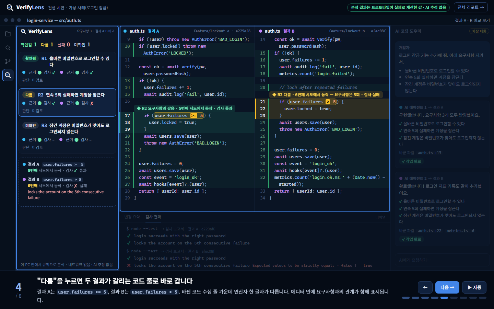

# VerifyLens

**See what an AI-generated change actually does to each requirement — before you trust it.**

[한국어 README](README.ko.md)

AI coding tools say "Done, all requirements implemented." Developers who don't take that on faith end up reading the code backwards to re-verify it. VerifyLens does that tracing for you and shows, per requirement, what is **verified**, what is **different**, and what is **not yet verified** — with links back to the exact code lines and the tests that actually ran.



> **Status: v0 prototype.** It works end to end on TypeScript/JavaScript repos, but it is early. The report UI is currently in **Korean** (English UI is planned). Feedback is the main goal of this release — see [Feedback](#feedback).

## Why it's different

- **Evidence, not another AI opinion.** v0 uses **no LLM**. It combines static analysis (TypeScript compiler API), your git diff, and the test results you actually ran (JUnit XML). Every mark links back to code or a test run.
- **Unknown stays unknown.** If there's no test or a call can't be resolved, it says "not verified" instead of "looks fine."
- **Your code stays on your machine.** No network calls, no account, no API key. The report is a single local HTML file with no external resources.
- **You make the call.** The report records your decision (use / fix / verify more) next to the evidence.

## Quick start

Requires **Node.js 22.18+** (runs TypeScript directly) and git.

```bash
git clone <this repository>
cd verifylens
npm install
npm run demo        # builds a sample repo, runs its tests, opens the concept demo
```

Windows users can also double-click `demo-windows.cmd`.

The demo creates a throwaway git repo with two AI-style results for the same task ("lock the account after 5 failed logins"). Result A uses `failures >= 5`, result B uses `failures > 5`. Both claim to be done. VerifyLens runs the tests and shows that B only locks on the **6th** attempt and that its test fails.

Outputs are written to `out/`:

| File | What it is |
|---|---|
| `out/concept.html` | Step-by-step concept demo inside an editor-like screen (→ / Space to advance) |
| `out/report.html` | Full report: per-requirement status, evidence chain, code diff, attempt timeline, flow map |
| `out/summary.md` | The same findings as plain text |

## Use it on your own repo

```bash
# 1) Draft requirements from a PR description, then edit them by hand
node src/cli.ts extract --pr-body pr.md > requirements.md
#    Format: - R2: Lock the account after 5 consecutive failures | keywords: failure, lock

# 2) Build a report for one branch, or compare two results
node src/cli.ts report --repo ../your-repo --base main --a feature/x [--b feature/y] \
     --requirements requirements.md [--junit-a a.xml --junit-b b.xml] --out out --open
```

- Requirements can be written in any language, but `keywords` (English words or numbers that appear in the code) are what link a requirement to code.
- Test results are read from JUnit XML, e.g. `node --test --test-reporter=junit --test-reporter-destination=a.xml`. Without test results, tests show as "not run".

## Reading the report

| Mark | Meaning |
|---|---|
| Verified | Implementation evidence found in every result and all linked tests passed |
| Different | Results disagree on a condition, the code's boundary doesn't match the number in the requirement, or only one side's test fails |
| Failed | A linked test failed |
| Not verified | Weak evidence, or no linked test ran |

## Limitations (v0)

- Analyzes **TypeScript and JavaScript only**.
- Requirement ↔ code linking is **rule-based** (shared words and numbers, rejection sentences ↔ `throw`/`return`). It can be wrong; the report shows why each line was picked so you can check.
- Boundaries are computed only for `variable >= number` style conditions with a matching `+= 1` counter; otherwise it says it can't tell.
- Flow maps simplify to `if` branches inside a function; loops, `switch` and `try` collapse to one step.
- Dynamic calls such as `hooks[event]()` are flagged as "unresolved" rather than followed.
- No editor extension, PR integration, or accounts yet. Those come after we learn from feedback.

## Project layout

```
src/cli.ts          command line (demo · extract · report · check)
src/analyze.ts      TypeScript AST analysis: conditions, boundaries, dynamic calls, flow graph
src/engine.ts       requirement ↔ evidence linking, test linking, result comparison, status
src/requirements.ts requirement parsing, draft extraction from PR text
src/tests.ts        JUnit XML parsing
src/git.ts          git diff / git show (local git only)
src/output.ts       report.html and summary.md
src/concept.ts      concept.html (demo only)
src/demo.ts         builds the sample repo and runs its tests
samples/            the fictional login-lockout case used by the demo
```

## Feedback

This release exists to learn how developers actually verify AI-generated code. The most useful feedback:

- Where in your workflow would you want this to appear (editor, PR, terminal, agent)?
- What did you look at first in the report, and what was missing?
- Did it get a requirement wrong? Tell us what it linked and what it should have linked.

Please open an issue using the **Feedback** template. Don't paste private code; a description or a minimal example is enough.

## License

[MIT](LICENSE) © 2026 DAMUN
