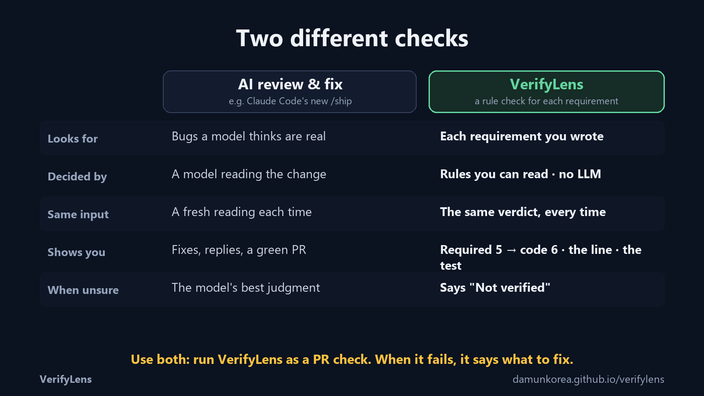

# VerifyLens for VS Code and Cursor

**See per requirement whether an AI-generated change is verified, different, or not yet verified — right next to your code.**

The AI says "Done, all requirements implemented", and **every test passes.** The requirement can still be unmet.

```text
Requirement    Lock the account after 5 consecutive failures
AI's code      if (user.failures > 5) { user.locked = true }
AI's test      'locks the account after 5 consecutive failures'  → passes ✓
VerifyLens     ← R2 · Different · acts on attempt 6 (requirement: 5) · but the test passes
```

The AI wrote the code and the test with the same misunderstanding. The test is named "after 5 failures" but actually checks after six failed attempts. So **every test passes, and the requirement is still not met.** Running the tests does not show this; computing when the condition fires does.

VerifyLens checks each requirement against your git diff and the tests that actually ran, before you commit, and shows the result in a side panel, as highlighted lines, and as a lens above the code that decides each requirement.

- **No LLM, and your code never leaves your machine.** Static analysis (TypeScript compiler API) + git + your JUnit test results, all local. The only optional network use is *Import requirements*, which reads a PR's or issue's text through your own `gh`.
- **Unknown stays unknown.** No test or an unresolved call means "not verified", never "looks fine".
- **You decide.** Every mark links back to the code line or test that produced it.
- **Same input, same verdict.** Rules, not a model reading your change afresh each time.

**Next to AI review tools.** AI review and fix tools, such as Claude Code's new `/ship`, tell you what a model thinks of a change and fix what they find. VerifyLens checks each requirement you wrote, by rules, and points at the exact line. Run it as a pull request check with the [GitHub Action](https://github.com/DamunKorea/verifylens#use-it-in-ci-github-actions): when it fails, the log says what to fix, for you, your agent or a fixer tool. ([More](https://github.com/DamunKorea/verifylens#next-to-ai-review-and-fix-tools). We have not tried it with `/ship` ourselves yet.)




> v0 preview: analyzes **TypeScript and JavaScript**. The UI is in **English or Korean**, following VS Code's display language (`verifylens.language` overrides it).

**Editors:** checked on VS Code 1.146 and on **Cursor 3.29** (the same `.vsix`; the integration tests pass there too). In Cursor, use the editor window: extensions are not loaded in Cursor's agent window. Other VS Code–based editors (Windsurf, VSCodium) should accept the same file but have not been checked.

## Install

- **VS Code:** open the Extensions view, search for **VerifyLens** and click **Install** ([Marketplace page](https://marketplace.visualstudio.com/items?itemName=damun.verifylens)).
- **Cursor:** search for **VerifyLens** in the Extensions view and click **Install**. It comes from [Open VSX](https://open-vsx.org/extension/damun/verifylens). Other editors that use Open VSX (VSCodium, Windsurf) should find it the same way, but have not been checked.
- **Or from a file:** download the `.vsix` from the [latest release](https://github.com/DamunKorea/verifylens/releases/latest), then **Extensions → ⋯ → Install from VSIX…**.

## Try it in 10 seconds

1. Click the **VerifyLens** icon in the Activity Bar.
2. Click **Try the sample**.

The demo builds a small sample repo with two AI results for "lock the account after 5 failed logins". Result A uses `failures >= 5`; result B uses `failures > 5` and comes with a test the AI wrote alongside it. Both claim to be done, and all tests pass in both. VerifyLens shows:

- **Requirements panel:** R1 verified, R2 **different**, R3 not verified, with a badge for how many need attention.
- **In the editor:** the deciding line gets a status icon and a note at its end, for example `← R2 · Different · acts on attempt 6 (requirement: 5) · but the test passes`. Hover it for the evidence table and the warning that a passing test disagrees with the computed behavior.
- **Side by side:** click `Compare A ↔ B` above the line (or the compare icon in the list) to open VS Code's own diff editor at the line where the two results diverge.
- **Problems panel:** lines that need attention are listed there, so `F8` walks through them.
- **Report panel:** the full evidence chain. Click any code line in it to jump to that line in the editor.
- **Your decision:** record use / fix / verify more / hold from the list, the lens or the report. It shows next to the requirement.
- **PR summary:** the clipboard icon copies a GitHub-markdown summary (status, evidence line, when it acts, test result, your decision, what is still not verified) to paste into the PR, so the reviewer does not redo the check.

The demo runs its tests with Node.js 22.18+ if it finds one, and otherwise uses bundled test results.

## Use it on your branch

1. Fill in the requirements. Run **VerifyLens: Import requirements** to pull them from the current branch's GitHub PR and its linked issues, from an issue number, or from text you copied (Jira, Linear, chat). Or run **VerifyLens: Create requirements file** and type them. Either way you get `.verifylens/requirements.md`:
   ```
   - R1: Users can log in with the right password
   - R2: Lock the account after 5 consecutive failures
   ```
   Plain sentences are enough: English is linked by its own words, Korean through a fixed glossary (no LLM), and numbers are checked against conditions. If a requirement lands on the wrong code, append `| keywords: words, in, the, code`. Read the imported list before trusting it; it is extracted by rules (sections such as "Acceptance criteria" / "요구사항", checklists, "must / ~해야 한다" sentences, or just the title).
2. Run **VerifyLens: Check my changes**. No commit needed: it looks at your working tree, including uncommitted edits and new files, against the base branch (`main` / `master` / the remote default is picked for you).
   After that it **keeps itself up to date**: save a file, let an AI agent write one, commit, or edit the requirements, and the result refreshes on its own.
3. Click the beaker icon (**VerifyLens: Run tests and re-check**). It detects Vitest, Jest or `node --test` from `package.json`, runs them, reads the report and re-checks. For another runner set `verifylens.testCommand`. Test results that are older than the code are not used: a pass from before your edit proves nothing about the code as it is now.
4. To compare two AI attempts, run **VerifyLens: Compare two branches** (committed changes).

If your CI already writes a report, point `verifylens.junitPath` at it (JUnit XML, or Jest/Vitest JSON).

## Settings

| Setting | Default | |
|---|---|---|
| `verifylens.language` | `auto` | Language of the panel, editor notes, report and messages: `auto` (follow VS Code), `ko` or `en` |
| `verifylens.baseBranch` | (ask) | Branch to compare against |
| `verifylens.requirementsFile` | `.verifylens/requirements.md` | Requirements file, relative to the repo root |
| `verifylens.junitPath` | `.verifylens/test-report.xml` | Test report to read and write (JUnit XML or Jest/Vitest JSON) |
| `verifylens.testCommand` | (detect) | Command that runs the tests and writes the report to `${report}` |
| `verifylens.includeUncommitted` | `true` | Check uncommitted changes too, and re-check on save |
| `verifylens.nodePath` | `node` | Node.js used to run the demo's tests |
| `verifylens.autoRerun` | `true` | Re-run on commit, branch switch, or when the requirements file or JUnit report changes |
| `verifylens.inlineNotes` | `true` | Show the note at the end of evidence lines |
| `verifylens.problems` | `true` | List lines that need attention in the Problems panel |
| `verifylens.summaryLanguage` | `auto` | Language of the copied PR summary: `auto` (same as the panel), `ko` or `en` |
| `verifylens.ghPath` | `gh` | GitHub CLI used by *Import requirements* |

## Limitations

- Comparing two branches looks at committed changes only.
- Numeric rules are read from the sentence (`at least 8`, `under 14`, `at most 20`, `50,000`, `5만 원`, `30 minutes`) and compared with comparisons, constants (also imported ones), loop counts, schema rules such as `.min(8)` and settings such as `windowMs`. When the sentence or the code does not settle the boundary (`after 7 days` with `days >= 7`, a limit read from `process.env`), the result stays "not verified". Whether the condition sits on the right code path is not proven; other logic errors are caught only if a linked test fails.
- Requirement ↔ code linking is rule-based and can be wrong; the report shows why each line was picked.
- TypeScript and JavaScript only.

Source, issues and feedback: https://github.com/DamunKorea/verifylens

---

## 한국어 요약

AI가 「완료」라고 한 변경이 요구사항마다 **확인됨 · 다름 · 미확인**인지 에디터 옆에서 보여 줍니다. LLM과 네트워크를 쓰지 않고, 코드는 PC 밖으로 나가지 않습니다. 같은 입력이면 늘 같은 판정입니다.

**AI 리뷰 도구와 함께:** Claude Code 의 새 `/ship` 같은 AI 리뷰 · 고침 도구는 모델이 변경을 어떻게 보는지 알려 주고 찾은 것을 고칩니다. VerifyLens 는 내가 쓴 요구사항 하나하나를 규칙으로 확인하고 그 줄을 짚습니다. GitHub Action 으로 PR 검사에 두면, 실패할 때 로그에 「고칠 것」이 나옵니다(사람 · 에이전트 · 고침 도구 누구에게나). `/ship` 과 함께 쓰는 것은 아직 우리가 직접 해 보지 않았습니다.

- **화면 언어:** VS Code 화면 언어를 따릅니다(한국어면 한국어, 아니면 영어). 영어 VS Code에서 한국어로 보려면 설정 `verifylens.language`를 `ko`로 바꾸세요.
- **처음 써 보기:** 왼쪽 VerifyLens 아이콘을 누르고 **샘플로 해 보기**를 누르세요.
- **내 변경 확인:** **이슈 · PR에서 가져오기**(GitHub PR · 이슈 · 복사한 글)나 **요구사항 파일 만들기**로 요구사항을 채우고 **지금 브랜치 확인**을 누르세요. 커밋하지 않아도 됩니다. 그 뒤로는 저장할 때마다 스스로 다시 확인합니다.
- **테스트 실행:** 목록 위 비커 아이콘을 누르면 Vitest · Jest · node:test 를 알아서 돌리고 결과를 반영합니다. 코드보다 오래된 테스트 결과는 쓰지 않습니다.
- **AI 결과 두 개 비교:** **두 브랜치 비교**를 쓰세요.

근거가 된 줄에는 아이콘과 줄 끝 설명이 붙고, 마우스를 올리면 근거 표가 나옵니다. 줄 위 **A ↔ B 비교**를 누르면 VS Code 기본 비교 화면으로 두 결과를 나란히 봅니다. 확인이 필요한 줄은 문제(Problems) 목록에도 올라가서 `F8`로 넘겨 볼 수 있고, 판단(사용 · 수정 · 추가 검증 · 보류)은 목록에서 바로 기록합니다. 목록 위 클립보드 아이콘을 누르면 PR에 붙일 **검증 요약**(상태 · 근거 줄 · 동작 시점 · 검사 · 판단 · 아직 확인 안 된 것)이 복사됩니다.
